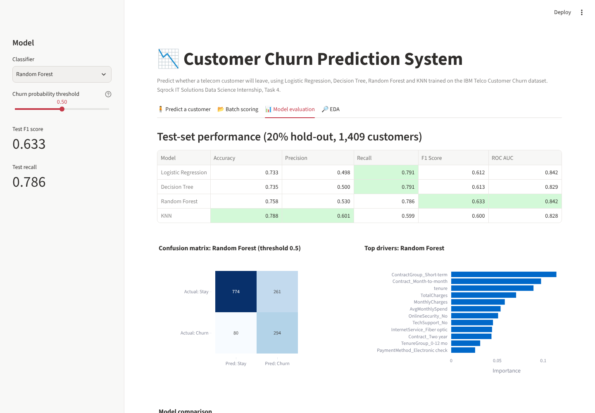

# Data Science Internship: Project Phase 1
**Sqrock IT Solutions** · Ajvi Dylgjeri

Three end-to-end machine learning projects. Each has a Jupyter notebook (the full analysis) and a deployed Streamlit web app.

| # | Project | Type | Best model | Key result | Live demo |
|---|---------|------|-----------|------------|-----------|
| 1 | [Sales Forecasting System](sales-forecasting/) | Time-series regression | ARIMA / Random Forest | MAE ↓ 40% vs naive baseline, MAPE ≈ 13% | `ADD-LINK` |
| 3 | [AI Resume Screening System](resume-screening/) | NLP / information retrieval | TF-IDF + cosine + skill matching | Correct top candidate for 3 out of 3 roles | `ADD-LINK` |
| 4 | [Customer Churn Prediction](churn-prediction/) | Binary classification | Random Forest (balanced) | Recall 0.79, F1 0.63, ROC AUC 0.84 | `ADD-LINK` |



## Repository structure
```
├── sales-forecasting/
│   ├── Sales_Forecasting.ipynb   # cleaning → EDA → features → LR/DT/RF/ARIMA → MAE/RMSE
│   ├── app.py, sales_model.py    # Streamlit app + reusable pipeline
│   └── data/superstore_sales.csv
├── resume-screening/
│   ├── Resume_Screening.ipynb    # PDF parsing → NLP preprocessing → TF-IDF/BoW → ranking
│   ├── app.py, screener.py
│   ├── generate_sample_data.py   # creates the sample resumes and job descriptions
│   └── data/{resumes,job_descriptions}/
├── churn-prediction/
│   ├── Churn_Prediction.ipynb    # EDA → features → LR/DT/RF/KNN → metrics + confusion matrix
│   ├── app.py, churn_model.py
│   └── data/telco_customer_churn.csv
├── screenshots/                  # images for README and LinkedIn
└── DEPLOYMENT.md                 # GitHub + Streamlit Community Cloud steps
```

## Run locally
```bash
git clone https://github.com/ajvidylgjeri/sqrock-data-science-internship.git
cd sqrock-data-science-internship/churn-prediction     # or sales-forecasting / resume-screening
pip install -r requirements.txt
streamlit run app.py               # web app
jupyter notebook                   # notebook
```

## Tech stack
Python · Pandas · NumPy · Matplotlib · Seaborn · Plotly · Scikit-learn · Statsmodels (ARIMA) · NLTK · PyPDF2 · Streamlit · Jupyter

## Datasets
- **Superstore Sales**: 8,399 real order lines, 2009-2012 (public dataset, mirrored from [curran/data](https://github.com/curran/data)).
- **IBM Telco Customer Churn**: 7,043 customers ([IBM GitHub](https://github.com/IBM/telco-customer-churn-on-icp4d), same as the Kaggle version).
- **Resumes**: 14 fictional resumes and 3 job descriptions generated by `resume-screening/generate_sample_data.py`.
