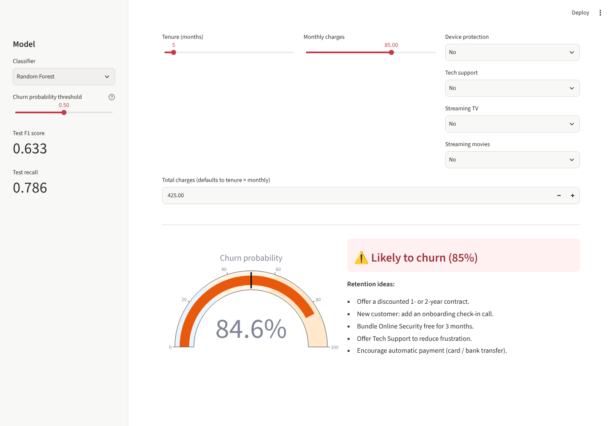
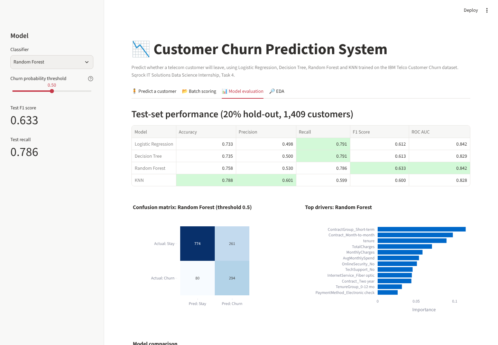

# 📉 Customer Churn Prediction System
*Task 4: Sqrock IT Solutions Data Science Internship*

Predicts whether a telecom customer will leave, explains the main churn drivers, and suggests retention actions.

**Live app:** `ADD-LINK` · **Notebook:** [Churn_Prediction.ipynb](Churn_Prediction.ipynb)



## Dataset
IBM Telco Customer Churn: 7,043 customers and 21 columns (demographics, services, contract, billing, `Churn`). 26.5% of customers churned.

## Pipeline
1. **Preprocessing:** `TotalCharges` text → number (11 blanks are tenure-0 customers, filled with 0), Yes/No → 1/0, one-hot encoding, `StandardScaler`, stratified 80/20 split. Everything runs inside a scikit-learn `Pipeline`, so nothing leaks from the test set.
2. **EDA:** churn distribution (bar and pie), monthly charges vs churn, tenure vs churn, churn rate by contract, internet and payment method, correlation heatmap.
3. **Feature engineering:** `AvgMonthlySpend`, `ContractGroup` (short- vs long-term), `NumServices`, `TenureGroup`. `customerID` is dropped.
4. **Models:** Logistic Regression (baseline), Decision Tree, Random Forest and KNN, with `class_weight="balanced"` to handle the class imbalance.
5. **Evaluation:** accuracy, precision, recall, F1, ROC AUC, confusion matrices and ROC curves.

## Results (test set, 1,409 customers)
| Model | Accuracy | Precision | Recall | F1 | ROC AUC |
|---|---|---|---|---|---|
| Logistic Regression | 0.733 | 0.498 | 0.791 | 0.612 | 0.842 |
| Decision Tree | 0.735 | 0.500 | 0.791 | 0.613 | 0.829 |
| **Random Forest** | 0.758 | 0.530 | 0.786 | **0.633** | **0.842** |
| KNN | 0.788 | 0.601 | 0.599 | 0.600 | 0.828 |

Random Forest catches about 4 in 5 churners. Without class weighting, its recall drops to about 0.50, which is why I focused on recall and F1 rather than accuracy.

**Top churn drivers:** month-to-month contract, short tenure, high monthly charges, fiber optic internet, electronic check payment, and no online security or tech support.

## Web app features
- **Single customer:** fill in a profile and get a churn probability gauge plus tailored retention ideas
- **Batch scoring:** upload a CSV and download ranked churn probabilities
- Model switcher, adjustable decision threshold, confusion matrix, feature importance and EDA charts



## Run
```bash
pip install -r requirements.txt
streamlit run app.py
```
