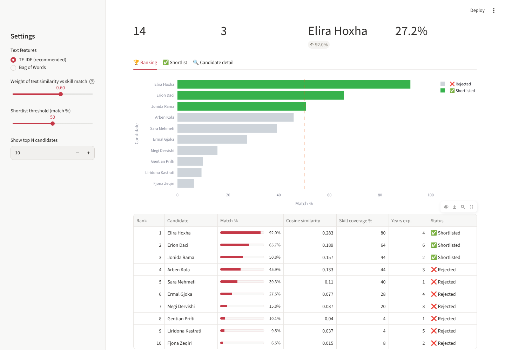

# 📄 AI Resume Screening System
*Task 3: Sqrock IT Solutions Data Science Internship*

Reads resumes (PDF/TXT), compares them with a job description using NLP, and ranks and shortlists candidates with an explainable match score.

**Live app:** `ADD-LINK` · **Notebook:** [Resume_Screening.ipynb](Resume_Screening.ipynb)



## How it works
1. **Text extraction:** PyPDF2 for PDFs; TXT is read directly.
2. **NLP preprocessing:** lowercase → remove emails, URLs, punctuation and digits → tokenize → remove stopwords → Porter stemming (NLTK).
3. **Feature extraction:** TF-IDF on unigrams and bigrams (recommended), with Bag of Words as an alternative.
4. **Matching:**
   - **Cosine similarity** between the job description vector and each resume vector
   - **Keyword matching** against a vocabulary of about 90 skills, with aliases such as *sklearn → scikit-learn*
5. **Score:** `Match % = 60% × relative text similarity + 40% × skill coverage`
6. **Ranking:** sorted list, threshold-based shortlist, matched and missing skills, years of experience, and email.

## Results on the sample data
14 fictional resumes from 7 professions, screened against 3 job descriptions:

| Role | #1 | #2 | #3 |
|---|---|---|---|
| Data Scientist | Elira Hoxha (92%) | Erion Daci (66%) | Jonida Rama (51%) |
| Frontend Developer | Dritan Basha (97%) | Gentian Prifti (68%) | Megi Dervishi (42%) |
| Data Engineer | Ermal Gjoka (100%) | Elira Hoxha (27%) | Arben Kola (26%) |

Unrelated profiles (HR, accounting, marketing) score below 10% on the technical roles.

## Web app features
- Pick a sample job or paste any job description, then use the sample resumes and/or **upload your own PDFs**
- Adjust the similarity vs skill weight and the shortlist threshold, and switch between TF-IDF and BoW
- Ranking chart, shortlist CSV download, and a per-candidate view of matched and missing skills

## Run
```bash
pip install -r requirements.txt
python generate_sample_data.py   # optional: regenerates data/resumes and data/job_descriptions
streamlit run app.py
```
