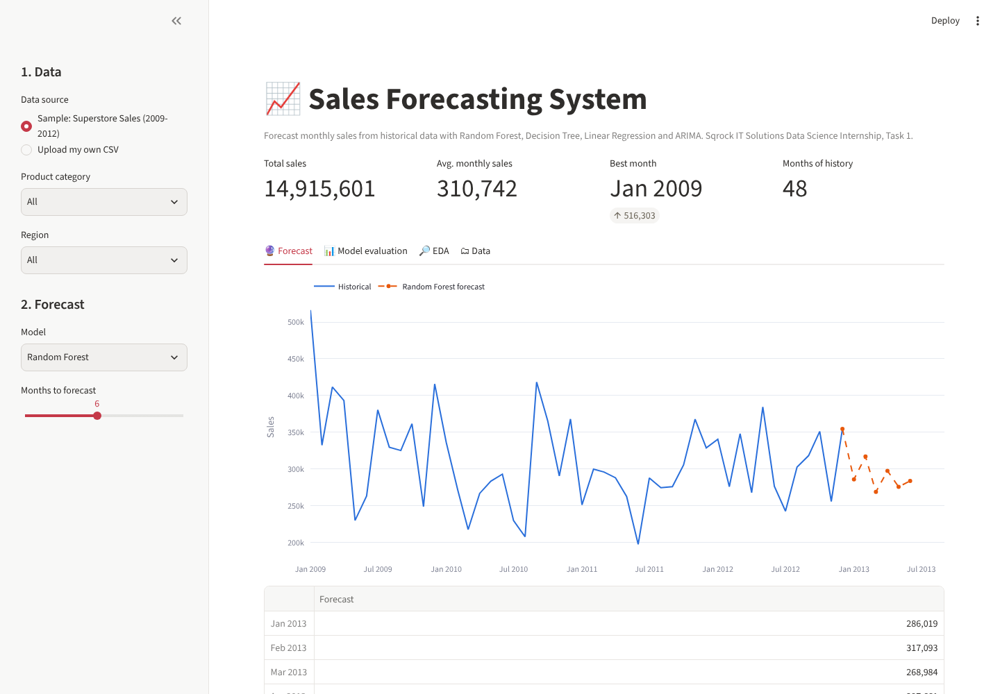

# 📈 Sales Forecasting System
*Task 1: Sqrock IT Solutions Data Science Internship*

Analyses four years of retail orders and forecasts future monthly sales with machine learning and time-series models.

**Live app:** `ADD-LINK` · **Notebook:** [Sales_Forecasting.ipynb](Sales_Forecasting.ipynb)



## Dataset
Superstore Sales: 8,399 order lines (Jan 2009 – Dec 2012) with order date, sales, product category, region and customer segment.

## Pipeline
1. **Data cleaning:** parse dates, remove duplicates, fill the 63 missing `Product Base Margin` values with the sub-category median.
2. **EDA:** monthly trend with rolling mean, top and bottom months, seasonality by calendar month, year × month heatmap, sales by category and region.
3. **Feature engineering:** month, year, quarter, days in month, lag 1/2/3/12, rolling 3- and 6-month means. All of them use past data only.
4. **Models:** Linear Regression, Decision Tree, Random Forest, and ARIMA(1,0,1)(1,0,0,12), compared against a naive "last month" baseline.
5. **Evaluation:** time-based split with the last 12 months (2012) as the test set. Metrics are MAE and RMSE (plus MAPE).
6. **Forecast:** retrain on all data and forecast the next 6 months (recursive for RF, with an 80% interval for ARIMA).

## Results (2012 hold-out)
| Model | MAE | RMSE | MAPE |
|---|---|---|---|
| **ARIMA** | **39,600** | **44,383** | 13.1% |
| Random Forest | 41,751 | 54,049 | 12.9% |
| Decision Tree | 47,460 | 58,550 | 15.5% |
| Naive (last month) | 65,766 | 74,186 | 21.6% |
| Linear Regression | 101,749 | 119,621 | 32.1% |

ARIMA and Random Forest cut the error by about 40% compared with the baseline. Linear Regression overfits on only 24 training months with highly correlated lag features.

## Web app features
- Sample data filtered by **category** and **region**, or **upload your own CSV** (pick the date and sales columns)
- Choose the model and a 1–12 month horizon, then download the forecast as CSV
- Back-test table and actual-vs-predicted chart, plus EDA tabs

## Run
```bash
pip install -r requirements.txt
streamlit run app.py
```
